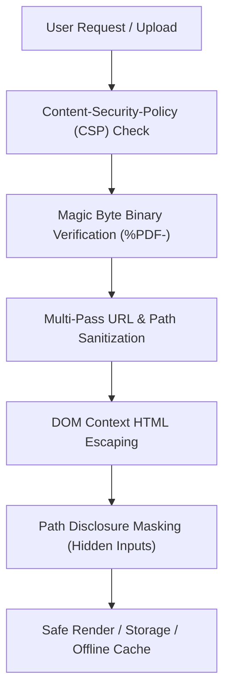

# SS+2 HIGH SCHOOL GHAGHRA • IT / ITeS Vocational Study Portal

[](https://web.dev/progressive-web-apps/)
[](./notes/)
[](./index.html)
[](./js/security.js)
[](./sw.js)

An offline-first, self-hosted **Progressive Web App (PWA)** engineered for students and teachers of **SS+2 High School Ghaghra (Gumla, Jharkhand)**. The portal provides instant, zero-bandwidth access to **142 physical PDF study notes, board examination papers, and official textbooks** for Vocational Information Technology (**IT / ITeS**) across Classes 9th, 10th, 11th, and 12th.

---

## 🏛️ School & Curriculum Context

- **Institution**: SS+2 High School Ghaghra, Gumla, Jharkhand (एस.एस. +2 उच्च विद्यालय घाघरा)
- **Academic Session**: 2025 – 2026
- **Subject**: Information Technology (IT / ITeS)
- **Vocational Trades**:
  - **DDEO** (Domestic Data Entry Operator) — Classes 9th & 10th (LibreOffice Writer, Calc, Impress & Employability Skills)
  - **JSD** (Junior Software Developer) — Classes 11th & 12th (Python, MySQL Relational Database, Networking, OS & Boolean Logic)
- **Mission**: In rural and semi-urban learning environments with patchy mobile connectivity and limited data packs, students need uninterrupted access to high-quality digital notes. This portal stores **all 142 study documents directly within the application repository**, enabling complete offline study on Android smartphones, tablets, and desktop computers without internet.

---

## ✨ Key System Features

### 1. 🚀 100% Self-Hosted & Offline Study Architecture
- **Zero Third-Party Cloud Dependencies**: Completely replaces external Google Drive links with physical self-hosted files stored under [`./notes/`](./notes/). Eliminates broken links, access permission requests, Google sign-in walls, and 404 cloud errors.
- **Service Worker Offline Cache (`sw.js` v21)**: Pre-caches the application shell, visual assets, fonts, and visited notes in Cache Storage. When a student opens the portal once or installs the PWA, notes open instantly even in **Airplane Mode** with zero cellular data.
- **Client-Side Storage**: Leverages IndexedDB and LocalStorage (`js/storage.js`) for storing custom uploaded notes, notices, and issue reports without requiring external server backends or database instances.

### 2. 📲 Android PWA Installation with Visual Step-by-Step Guide
- **Single-Tap Installation**: Clean, un-cluttered header prompt banner with one primary **`⬇️ Install App`** button capturing Android's native `beforeinstallprompt` event.
- **Illustrated "How To" Process**: Accompanied by a dedicated **`📖 How To`** button that opens a high-clarity modal with **4 custom SVG illustrations**:
  1. [`img/pwa-step1-menu.svg`](./img/pwa-step1-menu.svg): Locating Chrome's Three Dots (`⋮`) menu at top-right.
  2. [`img/pwa-step2-install.svg`](./img/pwa-step2-install.svg): Selecting *"Install app"* or *"Add to Home screen"*.
  3. [`img/pwa-step3-confirm.svg`](./img/pwa-step3-confirm.svg): Confirming the native Android install prompt.
  4. [`img/pwa-step4-success.svg`](./img/pwa-step4-success.svg): Launching directly from the phone home screen in fullscreen app mode.

### 3. ⚡ Running Marquee Live Ticker (Cyber-Neon Aurora Design)
- **Live Broadcast Banner**: Positioned right at the top of the home screen, highlighting active notices and newly added notes in a smooth, continuous ticker.
- **Abstract Visual Aesthetics**:
  - Deep cosmic plum canvas (`#0e0728` to `#032b43`) layered with glowing radial mesh orbs in **Electric Magenta (`#f43f5e`)**, **Cyber Cyan (`#06b6d4`)**, and **Ultraviolet (`#a855f7`)**.
  - Pinned angled badge (`clip-path: polygon(...)`) with animated pulsing neon dot (`⚡ FLASH TIPS`).
  - Studio edge fades via CSS mask-image gradients (`linear-gradient(to right, transparent, black, transparent)`).
- **Dynamic Content**:
  - 📢 **Official School Notices**: Real-time notices published via Admin. Click to view circular PDF.
  - ✨ **Newly Added Notes**: Highlights newly uploaded notes from local storage. Click to open directly.
  - 💻 **Vocational Trade Alerts**: Chapter alerts for DDEO, JSD, HTML tutorials, and JAC Board question banks.
  - 📲 **Offline Tips**: Guidance on studying offline without mobile data.
- **Hardware-Accelerated Dual-Track**: Pure CSS 60 FPS infinite translation (`@keyframes marqueeRun`) with seamless zero-gap track duplication and **instant pause on hover or touch**.

### 4. 🎯 Dual-Mode Educational Navigation
- **Primary: Vocational Folder Categories**:
  - Browse notes categorized by vocational trade and practical modules (DDEO, JSD, Official Books, HTML Notes, Question Banks, Question Papers, Resources, All Classes).
  - Subfolder filter pills (`Class 9`, `Class 10`, `Common`, `Part A`, `Part B`, `Practice Sets`).
- **Secondary: Diamond 4-Quadrant Class Selector**:
  - Geometric SVG diamond quadrant for Classes 9th (Emerald Green), 10th (Royal Blue), 11th (Amber Gold), and 12th (Crimson Rose).
  - Ambient drop shadows, center glow filters, and smooth scale transitions.

### 5. 📄 Safe In-App PDF Viewer & Direct Downloader
- **Embedded Document Viewer**: High-performance iframe modal with eager loading, fullscreen capability, and direct download buttons.
- **Space & Unicode URL Normalization**: Built-in recursive decode/encode loop in `Security.sanitizeUrl` preventing double-encoding (`%2520`) bugs on folders with spaces (e.g. `ALL CLASSES`, `HTML Notes`).
- **Path Disclosure Protection**: Internal server folder paths (`./notes/...`) are strictly hidden from student view.

### 6. 🚩 Student Issue Reporting System
- **One-Click Issue Reporter**: Directly accessible from the PDF viewer (`⚠️ Report Issue`).
- **Reporting Categories**:
  - Cannot View / Blank Screen or Error opening PDF
  - Download Failed / Broken or Corrupted File
  - Wrong Class, Subject, or Syllabus Unit
  - Missing Pages, Blurry Text, or Cut-Off Content
  - Extremely Slow to Load or Freeze
- **Admin Feedback Loop**: Reports are recorded in LocalStorage and instantly visible inside the Admin Portal with an expandable file association toggle (`📁 View File Association`) and optional email fallback.

### 7. 🔐 Teacher & Staff Admin Portal (`admin.html`)
- **Direct 1-Click Access**: Dedicated **`🔐 Admin`** pill button embedded in the main page header and Page 2 navigation bar.
- **Secure Authentication**: SHA-256 PBKDF2 PIN verification (default PIN: `1234`), 5-attempt rate-limiting lockout, and auto-expiring session management.
- **Multi-Mode PDF Upload Engine**:
  - Mode A: Direct file upload with **`%PDF-` binary magic-byte verification** and IndexedDB blob persistence.
  - Mode B: Relative codebase path indexing.
- **Self-Healing Library Auto-Repair Engine (`js/manifest.js`)**:
  - Automatically verifies all 142 physical files in `notes/` against the physical file manifest.
  - Fixes path associations and indexes unmanifested files.
  - Runs completely silent with clean toast feedback and zero disruptive popups.
- **Notices Publisher**: Create, edit, and delete official school circulars with tags, dates, icons, and PDF attachments.
- **Issue Reports Manager**: Review student feedback, inspect document associations, resolve issues, or clear resolved tickets.

---

## 📁 142 Self-Hosted Notes Inventory

All 142 digital study materials are physically stored in the repository under [`./notes/`](./notes/):

| Folder Category | Notes Count | Vocational Trade / Level | Curriculum Coverage |
| :--- | :---: | :--- | :--- |
| **`DDO(DOMESTIC_DATA_ENTRY_OPERATOR)`** | **25 PDFs** | Classes 9th & 10th | LibreOffice Writer (Styles, Images, TOC), LibreOffice Calc (Formulas, Goal Seek, Linking), Keyboard Shortcuts & Employability Skills |
| **`JSD(JUNIOR_SOFTWARE_DEVELOPER)`** | **40 PDFs** | Classes 11th & 12th | Python Basics & OOPs, MySQL Relational Database & Cheat Sheets, Networking Protocols (OSI & TCP/IP), Operating Systems & Boolean Logic |
| **`QUESTION_PAPERS`** | **40 PDFs** | Classes 9th to 12th | JAC Board Annual Question Papers, Model Papers, Pre-Board Exams, Term Tests, Rail Tests & Answer Keys |
| **`QUESTION_BANKS`** | **7 PDFs** | Classes 9th to 12th | Official JAC & CBSE IT/ITeS Question & Answer Banks with Solved MCQs |
| **`BOOKS`** | **6 PDFs** | Classes 9th to 12th | Official Vocational Textbooks (DDEO Class 9, DDEO Class 10, JSD Class 11, JSD Class 12, IT/ITeS Hindi Edition) |
| **`HTML Notes`** | **10 PDFs** | Web Design & ICT | 10-Chapter Handwritten HTML Series (Introduction, Tags, Lists, Tables, Forms, Multimedia & Practice Sets) |
| **`RESOURCES`** | **10 PDFs** | Reference & Manuals | Python Programming Book, Database Schemas, Computer Organization Engineering Notes, MS Excel & ICT Guides |
| **`ALL CLASSES`** | **4 PDFs** | Foundational Basics | Computer Fundamentals, Generations of Computers & Comprehensive Handwritten Basics |
| **Total Physical Library** | **142 PDFs** | **Classes 9th–12th** | **100% Hosted in Codebase • Zero Cloud Dependencies** |

---

## 🛡️ Security Architecture & Threat Mitigation

The application adheres to a strict **Zero-Risk Security Hardened Policy** implemented in [`js/security.js`](./js/security.js) and HTTP headers:



1. **Content Security Policy (CSP)**:
   - Configured in [`index.html`](./index.html) and [`admin.html`](./admin.html) with `default-src 'self'`.
   - Disallows unauthorized external scripts, framing, objects, and external network calls.
2. **Magic-Byte Binary Verification**:
   - Inspects the first 4 bytes of uploaded files via `FileReader` and `Uint8Array`.
   - Requires `0x25 0x50 0x44 0x46` (`%PDF-`). Blocks disguised executables, scripts, or polyglot files regardless of file extension.
3. **Multi-Pass URL Sanitization & Space Normalization**:
   - `Security.sanitizeUrl` strips `javascript:`, `data:`, and `vbscript:` protocols.
   - Decodes recursively before applying `encodeURI` to eliminate `%2520` double-encoding 404 bugs on folder paths with spaces.
4. **Information & Path Disclosure Prevention**:
   - Internal server paths (`./notes/DDO...`) are masked from public/student modals.
   - Form inputs for file paths are rendered as `type="hidden"`.
5. **Anti-Brute-Force & Credential Security**:
   - SHA-256 PIN hashing with timing-safe comparison.
   - Enforces a 15-minute lockout after 5 consecutive incorrect PIN attempts.

---

## 📂 Project Directory Structure

```
SSHS/
├── index.html                  # Student Portal App Shell (Diamond Selector, Ticker & Folders)
├── admin.html                  # Staff Portal (Uploads, Notices, Repair Engine & Issue Feedback)
├── manifest.webmanifest        # Progressive Web App Manifest Configuration
├── sw.js                       # Service Worker (v21 Cache Storage & Offline Network Interception)
├── README.md                   # Comprehensive Project Documentation
│
├── css/
│   ├── styles.css              # Main App Styling (Cyber-Neon Ticker, PWA Guide & Responsive Layouts)
│   └── admin.css               # Admin Dashboard Layout, Tables, Badges & Modal Styling
│
├── js/
│   ├── app.js                  # Student Portal Controller, Marquee Engine, Viewer & Modal Handlers
│   ├── admin.js                # Admin Portal Controller, Authentication, Uploads & Issue Tracker
│   ├── data.js                 # Primary Vocational Hierarchy, Classes Data & Configuration
│   ├── manifest.js             # Physical File Manifest (142 Notes) & Self-Healing Repair Engine
│   ├── security.js             # Zero-Risk Security Engine (XSS, Magic Bytes, PIN Hashing, Path Safe)
│   ├── storage.js              # Persistence Layer (IndexedDB Blobs, LocalStorage & Data Merging)
│   └── sw-register.js          # Service Worker Lifecycle & Android Install Prompt Controller
│
├── img/                        # PWA Android Installation Illustrated Guides
│   ├── pwa-step1-menu.svg      # Step 1: Tap Chrome 3-Dots Menu (⋮)
│   ├── pwa-step2-install.svg   # Step 2: Select "Install app"
│   ├── pwa-step3-confirm.svg   # Step 3: Confirm Native Android "Install" Dialog
│   └── pwa-step4-success.svg   # Step 4: App Added to Phone Home Screen & Offline Ready
│
├── icons/                      # PWA High-Resolution Icons
│   ├── icon-192.png            # Android Home Screen Icon (192x192)
│   ├── icon-512.png            # Android Splash Screen Icon (512x512)
│   ├── icon-maskable-192.png   # Android Adaptive Maskable Icon (192x192)
│   └── icon-maskable-512.png   # Android Adaptive Maskable Icon (512x512)
│
├── notices/                    # School Notice & Circular Documents Directory (.gitkeep)
│
└── notes/                      # 142 Self-Hosted Educational PDF Study Materials
    ├── ALL CLASSES/            # Computer Fundamentals & Handwritten Foundational Notes (4 PDFs)
    ├── BOOKS/                  # Official DDEO & JSD Class 9-12 Textbooks (6 PDFs)
    ├── DDO(DOMESTIC_DATA_ENTRY_OPERATOR)/ # Class 9 & 10 Vocational Curriculum (25 PDFs)
    ├── HTML Notes/             # 10-Chapter Complete Handwritten HTML Tutorial Series (10 PDFs)
    ├── JSD(JUNIOR_SOFTWARE_DEVELOPER)/   # Class 11 & 12 Python, SQL & Networks Curriculum (40 PDFs)
    ├── QUESTION_BANKS/         # Official Question & Answer Banks with Solved MCQs (7 PDFs)
    ├── QUESTION_PAPERS/        # JAC Board Annual Exam Papers, Model Sets & Keys (40 PDFs)
    └── RESOURCES/              # Reference Manuals, Python Programming & DB Schemas (10 PDFs)
```

---

## 💻 Local Development & Testing

The portal is built using standard web standards (HTML5, CSS3, Vanilla ES6+ JavaScript) and requires **no node modules, build steps, or compilers**.

### 1. Serve via Python HTTP Server
```bash
# Navigate to project workspace
cd /home/sanjayks/projects/SSHS

# Start local HTTP server
python3 -m http.server 8080
```
Open **`http://127.0.0.1:8080`** in your web browser.

### 2. Testing Offline Functionality
1. Open the portal in **Google Chrome**.
2. Open Chrome DevTools (`F12` or `Ctrl + Shift + I`).
3. Navigate to the **Application** tab -> **Service Workers**. Verify `sw.js` is active.
4. Check the **Offline** checkbox under Network in DevTools or toggle **Airplane Mode** on your device.
5. Browse class notes, open PDFs, and navigate folders—all cached materials will load instantly with zero connectivity.

---

## ⚙️ Administration & Teacher Workflows

### Accessing Admin Portal
1. Tap the **`🔐 Admin`** pill button in the top-right header on the home screen (or use shortcut `Ctrl + Shift + A`).
2. Enter the Teacher PIN (Default: `1234`).
3. The dashboard displays live statistics on total notes, custom uploads, active notices, and reported issues.

### Publishing Official Notices
1. Navigate to **Notices & Announcements** tab.
2. Enter the Title, Subtitle, Notice Tag (e.g. `Exam`, `Notice`, `Practical`), and optional Date.
3. Attach an optional PDF document circular.
4. Tap **Publish Notice**. The notice is instantly broadcasted to the top **Running Marquee Ticker** and Page 1 Notice Board.

### Uploading New Study Notes
1. Navigate to **Upload New Note** tab.
2. Select Class (9th, 10th, 11th, 12th) and Vocational Folder.
3. Drop the PDF file into the upload zone (binary magic bytes are verified automatically).
4. Enter Title and Hindi Title.
5. Tap **Upload Study Note**. The file is stored in IndexedDB and instantly reflected in student searches and folder lists.

### Resolving Student Issue Reports
1. Navigate to **Reported Issues & Feedback** tab.
2. Inspect submitted issues submitted by students from the viewer.
3. Expand **`📁 View File Association`** to see which document is affected.
4. After verifying the file or uploading a replacement, tap **`✓ Mark Resolved`**.

### Running Self-Healing Library Repair
1. Tap the **`⚡ Check & Repair Paths`** button in the Admin toolbar.
2. The engine scans the physical file registry, verifies all 142 notes on disk, re-associates any moved files, and indexes new documents without interrupting the user.

---

## 📱 Hardware & Browser Compatibility

| Platform | Browser | PWA Install Support | Full Offline Support | PDF In-App Viewing |
| :--- | :--- | :---: | :---: | :---: |
| **Android 8.0+** | **Google Chrome** | ✅ Yes (1-Tap & 3-Dots) | ✅ Yes (Full Service Worker) | ✅ Yes (Native Viewer) |
| **Android** | **Samsung Internet** | ✅ Yes | ✅ Yes | ✅ Yes |
| **Windows / macOS** | **Chrome / Edge** | ✅ Yes (Omnibox Pill) | ✅ Yes | ✅ Yes |
| **Linux** | **Chromium / Firefox** | ✅ Yes | ✅ Yes | ✅ Yes |
| **iOS / iPadOS** | **Apple Safari** | ⚠️ Add to Home Screen | ✅ Yes (iOS Cache) | ✅ Yes (Safari PDF) |

---

## 📄 License & Attribution

- **Developed for**: SS+2 High School Ghaghra, Department of School Education and Literacy, Government of Jharkhand.
- **Subject**: Information Technology / Information Technology Enabled Services (IT / ITeS).
- **Academic Year**: 2025–26.
- **Maintainer**: Vocational IT / ITeS Department, SS+2 High School Ghaghra.
- **License**: Educational Open-Source License. Designed for non-commercial student learning and revision.
